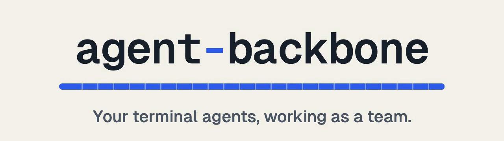
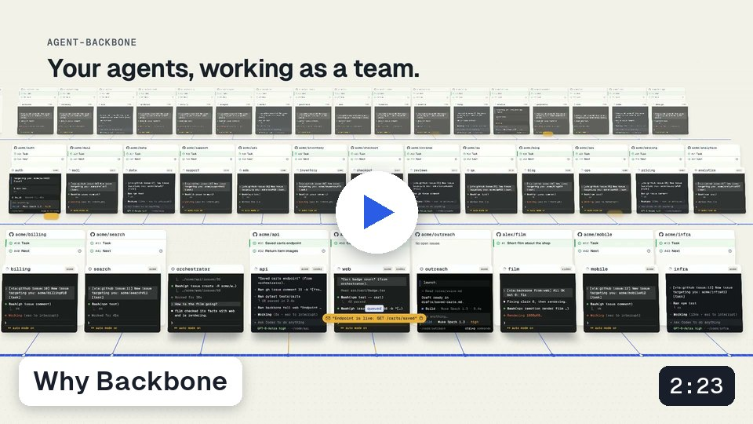
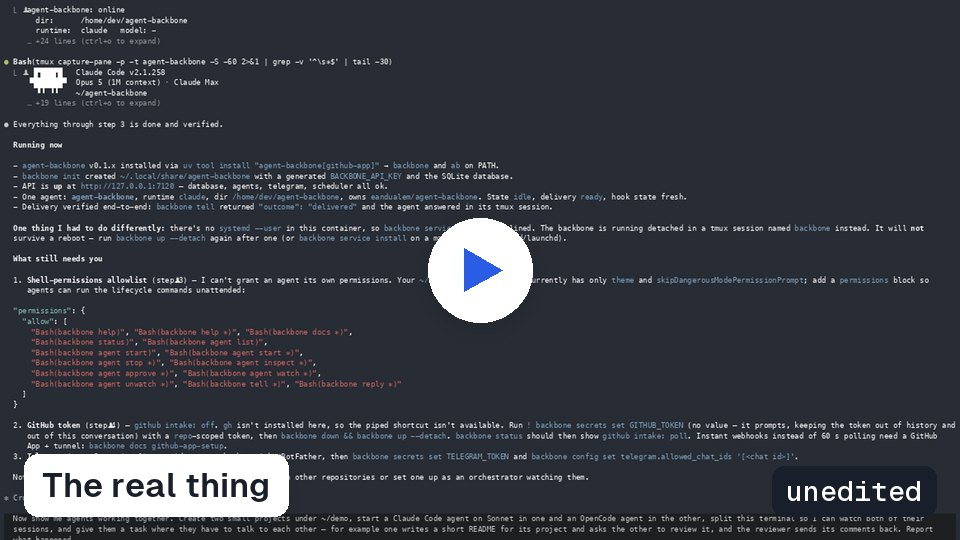
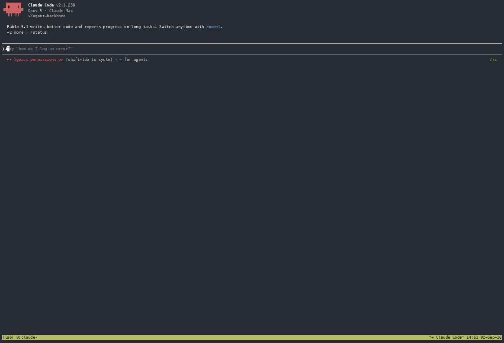

<div align="center">



**Claude Code, Codex and OpenCode, working as one team on your machine.**<br>
Agents message each other by name, take work from GitHub Issues and reach you on your phone.<br>
They use the logins you already have, and core use needs no setup in your repositories.

[](https://pypi.org/project/agent-backbone/)
[](https://pypi.org/project/agent-backbone/)
[](https://github.com/eandualem/agent-backbone/actions/workflows/ci.yml)
[](https://pypistats.org/packages/agent-backbone)
[](LICENSE)

[Watch](#watch) · [Quick start](#quick-start) · [Why Backbone](#why-backbone) · [Docs](docs/INDEX.md) · [Security](docs/security.md)

</div>

## Watch

VIDEO_OVERVIEW_URL

<p align="center"><sub>The overview, 1:23, captioned. Unmute for the narration.</sub></p>

<p align="center"><b>Up next</b>&nbsp;&nbsp;›<br>
<a href="docs/media/films.md#why-backbone"></a>
<a href="#see-the-real-thing"></a>
</p>

## Why Backbone

You already run coding agents in your terminal. Each one works alone, and you
carry every message between them. Backbone turns them into a team.

<table>
<tr>
<td width="50%" valign="top">

**Never typed into a busy agent**<br>
Agents reach each other by name. When the recipient is working or waiting
for you, the message waits in a durable queue and arrives as soon as the
agent is ready, marked with who sent it.

</td>
<td width="50%" valign="top">

**No setup in your repositories**<br>
An agent is a folder and the CLI you choose, and the folder is its name.
Core use adds no configuration files, task schemas or commits to your
projects.

</td>
</tr>
<tr>
<td valign="top">

**GitHub Issues are the task list**<br>
Label an issue `for:worker` and it lands in worker's queue, one at a time.
To hand work on, an agent opens an issue for another. The issue stays as the
record.

</td>
<td valign="top">

**Mix CLIs in one team**<br>
Claude Code, Codex and OpenCode agents work side by side, and a swarm puts a
coordinator and helpers on different CLIs on one branch. A second model can
review the change.

</td>
</tr>
<tr>
<td valign="top">

**In the loop from anywhere**<br>
Watch any agent, step into its terminal, or answer from your phone. With
Telegram connected, every agent gets its own topic, with Allow and Deny on
permission prompts.

</td>
<td valign="top">

**State you can check**<br>
Backbone tracks whether each agent is idle, working or waiting for a person,
and shows the evidence behind every reading. Your agents decide the work.

</td>
</tr>
</table>

New sessions are briefed on these tools, so you can ask any agent to set up
the team you need: an agent per repository, skills and rules shared by tag,
specialists on request.

## Quick start

**Let your agent do it.** Open the coding agent you already use and say:

```text
Install agent-backbone with uv tool install "agent-backbone[github-app]",
then run backbone help setup and follow it.
```

The setup playbook is written for agents: each step ends with a check and
says when it needs you, for your accounts and secrets.

**Or by hand.** You need macOS or Linux, Python 3.11+, tmux,
[uv](https://docs.astral.sh/uv/) (or pipx), and an agent CLI installed and
signed in.

```bash
uv tool install "agent-backbone[github-app]"
backbone init
backbone service install           # start now and at login
backbone doctor                    # check dependencies and API access
```

Then, from a repository you want an agent to work in:

```bash
cd ~/code/app
backbone agent start --runtime claude   # or --runtime codex, --runtime opencode
backbone tell app "Summarise what this repository does in three sentences."
backbone agent attach app               # read its reply; Ctrl-b d detaches
```

The folder supplies the agent name. If startup reports a prompt or a timeout,
`backbone agent inspect app` shows what needs attention. `tell` reports
whether the message was delivered or queued; a queued message arrives when
the agent is ready, so do not resend it. If `backbone` is not on your PATH,
run `uv tool update-shell` and open a new terminal. In a container without a
login service, use `backbone up --detach`. `ab` is a short alias; on macOS,
use `backbone` if Apache Bench shadows it.

[Getting started](docs/getting-started.md) walks through a second agent,
GitHub and Telegram. [Quick usage](USAGE.md) is the everyday command guide.

## See the real thing

The films above are animations. This is an unedited recording: installation
from PyPI, then a Claude Code agent and an OpenCode agent reviewing each
other's work on Linux, at 3× speed.



## Built to be relied on

- **One delivery gate.** Everything typed into an agent's terminal passes the
  same readiness check. Busy agents are never interrupted, and every message
  carries where it came from.
- **The same result on every required CLI.** A capability ships only when it
  works the same in Claude Code, Codex and OpenCode, checked by the same
  behaviour test on each. The [runtime capability table](docs/runtime-capabilities.md)
  and `backbone doctor` read one contract, and gaps are listed, not hidden.
- **More than 3,500 tests,** run on every change with no network, models or
  services.
- **Built with itself.** Backbone is developed by agents running inside a
  Backbone in daily use. The films in this README were made the same way.
- **An honest security model.** One trusted user on one machine, an API on
  localhost, and a clear account of what agents can reach. Read
  [Security](docs/security.md) before granting access.

Backbone is not an agent framework: it calls no models and needs no model API
keys. It is not a workflow engine or a dashboard either. It gives your
agents names, safe messages and evidence, and leaves the work to them.

## Works with

| CLI | Support |
|---|---|
| Claude Code, Codex, OpenCode | Required set: a capability ships only when it works on all three, and any open gap is tracked as a defect |
| Gemini CLI, Deep Code, Aider | Supported on demand; each gap is listed in the [capability table](docs/runtime-capabilities.md) |

## Going further

- [GitHub](docs/github.md): route issues and review notifications, starting with
  token-based polling. [GitHub App setup](docs/github-app-setup.md) adds webhooks.
- [Swarms](docs/swarms.md): put several specialists on one task.
- [Skills](docs/skills.md): keep one copy of each skill, tag it, and every agent
  with that tag finds it in its own CLI.
- [Telegram](docs/telegram.md): send messages and read reports from your phone.
- [Token usage](docs/token-usage.md): tokens by agent, conversation and model.
- [API](docs/api.md): build a dashboard or automation; Backbone ships no UI.
- [Runtime support and limits](docs/status-and-roadmap.md): checked capabilities,
  unsupported environments and known limitations.
- [How it works](docs/how-it-works.md): state detection, delivery and routing.

The [documentation index](docs/INDEX.md) covers configuration, diagnostics
and the remaining references. Installed copies are available through
`backbone docs`; `backbone help` contains short agent playbooks.

## Security model

Backbone runs as one trusted OS user on one machine. Agents are not isolated
from each other. The API binds to localhost by default and uses one full-admin
key; local sessions can read that key through the CLI. Backbone keeps its
control-plane secrets out of launched environments, but this is not a filesystem
security boundary. Read [Security](docs/security.md) before granting access or
exposing the API.

## Development

```bash
git clone https://github.com/eandualem/agent-backbone
cd agent-backbone
make install
make check
BACKBONE_DATA_DIR=/tmp/backbone-dev make dev
```

`make dev` runs on its own tmux server, so its agents stay apart from your own
tmux sessions and from a real backbone's agents. Run CLI commands for it from
a terminal outside tmux with the same settings, for example
`TMUX_TMPDIR=/tmp/backbone-dev-tmux-$(id -u) BACKBONE_DATA_DIR=/tmp/backbone-dev uv run backbone agent attach NAME`.
`agent attach`, and agent commands run while `make dev` is stopped, use tmux
directly.

See [Contributing](CONTRIBUTING.md) for branches, checks and releases.

## License

[MIT](LICENSE).
